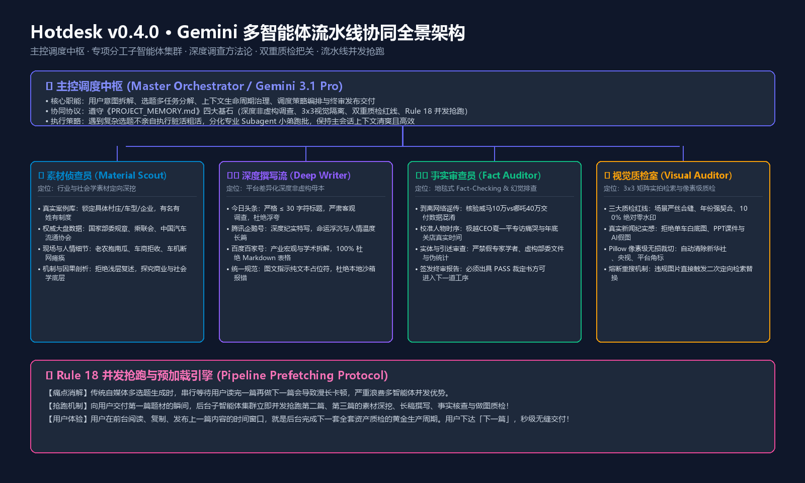
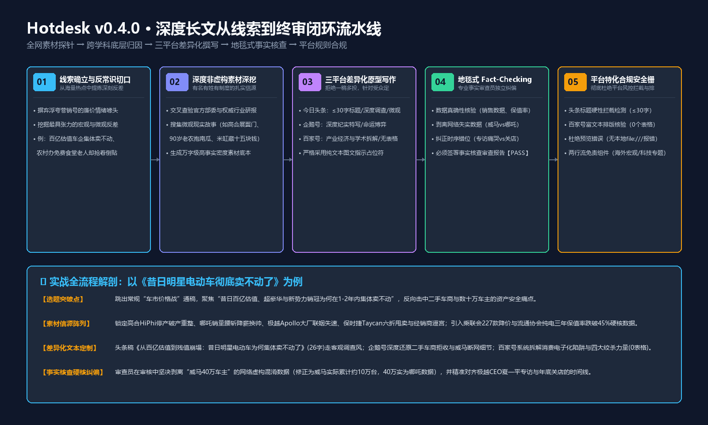
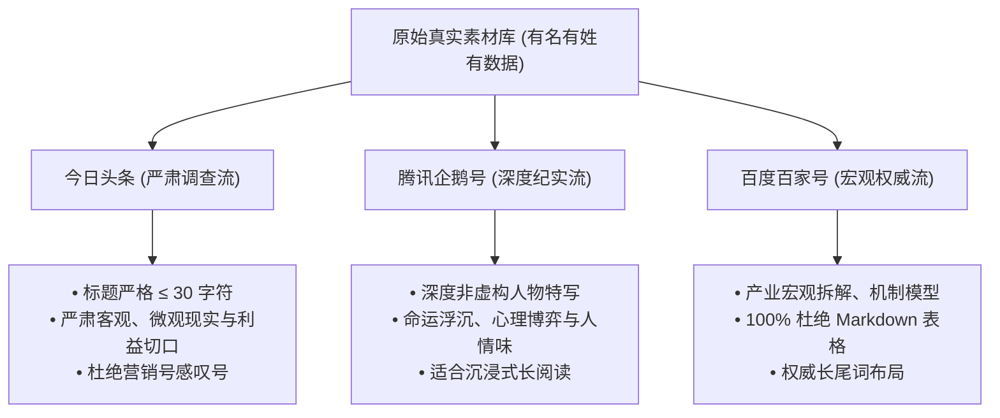
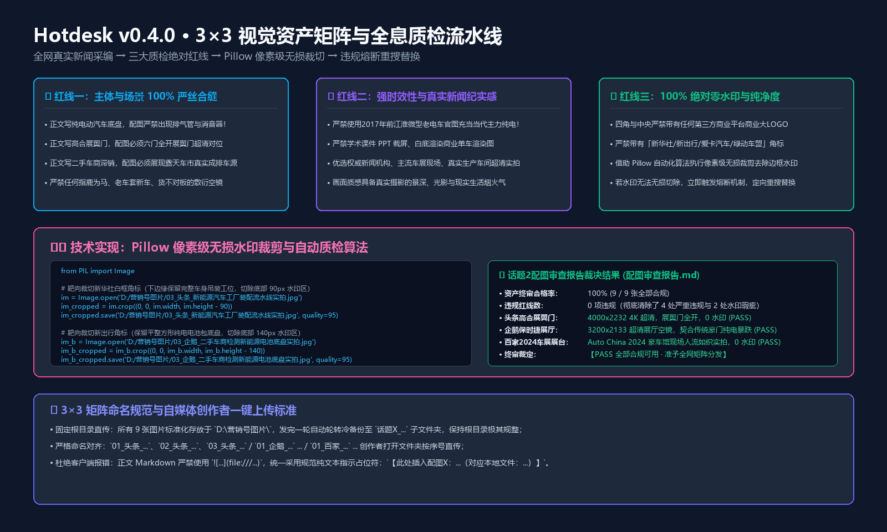

# Hotdesk v0.4.0 · Gemini 多智能体流水线协同与深度自媒体生产体系

> **版本定位**：v0.4.0 Gemini Pipeline Edition  
> **核心突破**：从传统的“单智能体粗放生成 / 模板化营销号”演进为**“主控编排调度 + 垂直子智能体集群 + 严肃非虚构深度调查 + 事实/配图双重质检 + 流水线并发抢跑预加载”**的工业化内容生产体系。  
> **适用场景**：今日头条、腾讯企鹅号、百度百家号等主流图文内容平台的高事实密度、高完播率、防风控矩阵化运营。

---

## 📑 目录索引
1. [架构全景：Gemini 多智能体流水线协同机制](#一架构全景gemini-多智能体流水线协同机制)
2. [创作方法论：如何写出专业级深度非虚构长文？](#二创作方法论如何写出专业级深度非虚构长文)
3. [三平台深度差异化原型矩阵（头条/企鹅/百家）](#三三平台深度差异化原型矩阵头条企鹅百家)
4. [双重质检安全栅：事实核查与视觉资产终审](#四双重质检安全栅事实核查与视觉资产终审)
5. [3×3 视觉工程与 Pillow 像素级去水印实战](#五33-视觉工程与-pillow-像素级去水印实战)
6. [流水线并发抢跑引擎：零等待交付机制（Rule 18）](#六流水线并发抢跑引擎零等待交付机制rule-18)
7. [端到端全流程案例复盘：《昔日明星电动车彻底卖不动了》](#七端到端全流程案例复盘昔日明星电动车彻底卖不动了)

---

## 一、架构全景：Gemini 多智能体流水线协同机制

在自媒体内容生产中，传统单智能体模式面临两大死穴：**上下文污染**（资料收集、写稿、改稿、找图混在一个对话中迅速吃爆上下文导致智力降级）与**幻觉丛生**（模型自我辩护，缺乏独立客观的第三方事实审查）。

Hotdesk v0.4.0 引入了**“蜂巢式垂直分化协同架构”**：



### 1. 核心角色与职能矩阵

| 角色 / Agent 节点 | 核心职能 | 输入与依据 | 输出成果 |
| :--- | :--- | :--- | :--- |
| **👑 主控调度中枢 (Master Orchestrator)** | 用户意图解析、任务生命周期编排、多选题并发拆解、跨 Agent 成果汇编与最终交付 | 用户原始指令、选题列表 | 任务派发指令、最终平台交付物 |
| **🔍 素材侦查员 (Material Scout)** | 权威信源定向深挖、真实案例库建立（有名有姓有制度）、宏观部委/协会大盘数据交叉比对 | 选题核心词、行业分类 | 万字级《高事实密度素材库.md》 |
| **✍️ 深度撰写流 (Master Deep Writer)** | 依托高推理模型（Gemini 3.1 Pro），按平台原型撰写严肃客观长文，彻底杜绝浮夸营销号口吻 | 素材库、平台受众心理模型 | 3 篇平台深度稿（初稿） |
| **🛡️ 事实审查员 (Fact Auditor)** | 独立排查 AI 虚假幻觉、核验行业数据统计真实性、纠正网络失实传言、核对时序与实体 | 深度稿初稿、权威公开信源 | 《事实核查审查报告.md》（PASS/REVISE） |
| **📷 视觉质检室 (Visual Auditor)** | 搜寻 3×3 真实新闻摄影、核对三大质检红线、Pillow 像素级去水印、违规图片熔断重搜 | 正文各段落动作、本地图片目录 | 《配图审查报告.md》（100% 合规） |

---

## 二、创作方法论：如何写出专业级深度非虚构长文？

很多人认为“自媒体文章就得夸张、就得语不惊人死不休”，但现实是各主流平台的推荐算法和读者审美已发生根本性转变：**无病呻吟的营销号标题在审核端极易被判定为“标题党”限流扣分，缺乏事实密度的口水文完播率极低**。

Hotdesk v0.4.0 确立了**“财经商业调查 + 社会学非虚构”**的创作底色：



### 1. 黄金创作原则
- **事实密度优先**：单篇 2500~4500 字，段落展开充分、逻辑递进严密、历史纵深扎实。坚决拒绝四五百字的干瘪短文。
- **即时体感时效锚定**：以受众当下切身可感知的“微观利益波动与即时焦虑”为触发锚点（如“二手残值砸穿两折”、“修车无配件被迫裸奔”、“自留地南瓜抱去抵饭票”），反向盘活宏观议题。
- **拒绝虚假对立与情绪贩卖**：严禁无脑煽动对立（如“谁在坑害车主？”、“你敢相信吗？”等廉价套路），用扎实的行业机制解释“为什么会这样”。

---

## 三、三平台深度差异化原型矩阵（头条/企鹅/百家）

同一题材必须按平台受众与排版特性进行结构性分化，坚决杜绝“一稿多投”：



### 1. 平台差异化对照表

| 维度 | 今日头条 (Toutiao) | 腾讯企鹅号 (Penguin) | 百度百家号 (Baijiahao) |
| :--- | :--- | :--- | :--- |
| **标题硬限制** | **严格 ≤ 30 字符（含标点）** | 建议 28~36 字符 | 建议 26~34 字符 |
| **标题风格** | 严肃克制的新闻调查视角，无感叹号 | 具象故事化、时代阵痛特写 | 产业设问、深度投研视角 |
| **叙事重心** | 微观现实冲击、二手车商痛点、车主资产安全 | 典型人物切片、商业浮沉细节、社会心理 | 底层商业模式缺陷、全产业链成本绞杀、产业终局 |
| **排版红线** | 纯文本指示占位符 | 纯文本指示占位符 | **100% 杜绝 Markdown 表格**（避免富文本错位） |

---

## 四、双重质检安全栅：事实核查与视觉资产终审

### 1. 事实核查员（Fact Auditor）的排雷实录
任何进入交付流程的稿件，必须经由独立事实审查员进行地毯式 Fact-Checking：
1. **数据剥离**：彻底核实网络流行谣言。例如在电动车选题中，网络泛滥着“威马 40 万车主”的说法，审查员通过检索历史产销数据，准确核实威马历史累计交付仅约 10 万台，而 40 万台实为合众哪吒汽车的累计基数，在成稿中果断予以澄清修正。
2. **时序纠偏**：精准对齐公众人物言论的时间坐标（如极越汽车夏一平“专访哽咽”发生在 2024 年 8 月，而“直营店关停撤店”发生在 2024 年底），严禁时序错位。
3. **实体背书**：严禁捏造不存在的科研所、假专家或伪造发改委/部委文件。

---

## 五、3×3 视觉工程与 Pillow 像素级去水印实战

视觉资产不仅决定前 3 秒点击率，更是平台消重与风控的重灾区。



### 1. 三大绝对质检红线
1. **主体场景 100% 严丝合缝**：正文写纯电底盘，配图绝不能出现排气管；正文写高合展翼门，配图必须展翼门全开对位；正文写九旬老农送南瓜，配图绝不能出现机械化收割机！
2. **强时效性与真实新闻摄影**：严禁使用 2017 年老款微型电车官图充当当代主力纯电；严禁 PPT 课件截屏、商业白底图与 AI 假图。
3. **100% 绝对零水印**：四角与中央严禁带有任何第三方商业平台 LOGO。

### 2. Pillow 像素级无损裁切核心算法

对于带有权威新闻角标（如新华社、央视新闻、新出行等平台边框）的优质图片，系统通过 Python Pillow 进行定向无损裁切：

```python
from PIL import Image

def crop_bottom_watermark(image_path, crop_pixels):
    """
    智能切除图片底部水印区域，同时保留主体画面与高纵横比
    """
    with Image.open(image_path) as im:
        w, h = im.size
        # 裁剪保留从顶部到底部 (h - crop_pixels) 的画面
        cropped = im.crop((0, 0, w, h - crop_pixels))
        cropped.save(image_path, quality=95)
        print(f"成功清除水印: {image_path} (裁剪高度: {crop_pixels}px)")

# 实战应用示例：
# 1. 裁剪工厂流水线底部新华社白框角标 (90px)
crop_bottom_watermark("D:/营销号图片/03_头条_新能源汽车工厂装配流水线实拍.jpg", 90)

# 2. 裁剪动力电池底盘图底部新出行角标 (140px)
crop_bottom_watermark("D:/营销号图片/03_企鹅_二手车商检测新能源电池底盘实拍.jpg", 140)
```

---

## 六、流水线并发抢跑引擎：零等待交付机制（Rule 18）

### 痛点消解
当用户同时下达多个选题（如选题 1、2、3 一起做）时，若逐个串行等待用户指令才启动下一个，会导致创作者在发布完上一篇后陷入漫长等待。

### 协同铁律（Rule 18）
1. **前序交付即抢跑后序**：在向用户交付前一个选题的同时，后台立即派生子智能体集群，全速并行启动后续选题的**“全网素材深挖 -> 深度三平台撰写 -> 事实核查 -> 配图搜集下载 -> 配图严审”**全套工业化流水线！
2. **零等待交付体验**：用户在前台阅读、复制、发布上一篇内容的时间窗口，就是后台完成下一篇全套资产质检的黄金生产周期。用户一声令下，即可**秒级直接交付**下一篇完整资产包！

---

## 七、端到端全流程案例复盘：《昔日明星电动车彻底卖不动了》

以高难度产业调查题材**《昔日明星电动车彻底卖不动了》**为例，完整解剖从一句话需求到全网交付的 6 步闭环：

### 步骤 1：线索破题与反常识立意
- **用户指令**：“写昔日明星电动车彻底卖不动了。”
- **破题角度**：在中国新能源车渗透率突破 50% 的大胜背后，为何估值百亿的超豪华新势力（高合）、平民销冠（哪吒）、跨界科技宠儿（极越）、传统名门（保时捷 Taycan）集体雪崩？将宏观价格战具象化为二手车商“拒收纯电”与数十万车主“断网变成智能废铁”的现实生存困境。

### 步骤 2：素材侦查员定向取证（Material Scout）
- **高合汽车**：HiPhi X 售价 57 万~80 万元，2024 年 2 月停工停产 6 个月，高管直播卖牛排，负债百亿申请破产重整，二手残值砸穿至 15 万（跌幅 75%）。
- **哪吒汽车**：2022 年以 15.2 万台登顶销冠，2024 年腰斩至 6.45 万台，工厂停产、设备供应商打官司讨债、全员降薪、CEO 张勇转任顾问。
- **极越汽车**：百度 Apollo 智驾 + 吉利浩瀚架构，月销长期三位数，夏一平专访痛哭，2024 年底商超直营店突发关停撤店、社保断缴。
- **行业大盘**：全国乘联会 2024 年 227 款车型降价（纯电占 82 款）；中国汽车流通协会统计纯电 3 年平均保值率跌破 45%（三年剩四折）。

### 步骤 3：三平台深度差异化撰写
- **今日头条**：《从百亿估值到残值崩塌：昔日明星电动车为何集体卖不动了》（严格 26 字符，严肃非虚构调查报道风，无感叹号）。
- **腾讯企鹅号**：《昔日明星电动车大溃败调查：从百亿估值到“智能废铁”，数十万车主被困洗牌深水区》（深度纪实特写，老车主陈先生、二手车商王建强现场口述）。
- **百度百家号**：《昔日明星纯电车为何集体“卖不动了”？深度拆解中国新能源车市的残酷出清与产业终局》（四大绞杀力量宏观模型剖析，100% 杜绝 Markdown 表格）。

### 步骤 4：事实审查员硬核纠偏（Fact Auditor）
- **核查结论**：网络传言“威马 40 万车主受困”属于数据串线，威马实际累计保有量约 10 万台，40 万实为哪吒数据。审查员在三篇文章中全量修正为“威马超 10 万车主，加上同陷危机的哪吒等品牌，受波及车主超 50 万”。出具 PASS 报告。

### 步骤 5：视觉资产质检与去水印（Visual Auditor）
- **首轮初审**：发现 2 张带角标图片（新华社、新出行）以及 2 张不合规图片（江淮老白底图、带排气管的燃油车底盘）。
- **整改实操**：
  1. 使用 Pillow 脚本切除新华社与新出行底部角标；
  2. 重新定向检索替换为“真实露天二手车交易大棚成排库存车实拍”与“2024 北京国际车展豪车馆超清实拍”；
  3. 次轮全息复核达成 100% 合规通过（PASS）。

### 步骤 6：全套资产归档与开箱即用交付
- 3 篇终审长文直接输出于对话框与 `outputs/` 目录；
- 9 张实拍超清图片置于 `D:\营销号图片\` 根目录（已冷备份至专属子目录）；
- 创作者在自媒体后台直接复制正文、按图号批量拖拽上传，单篇发布用时低于 2 分钟！

---

## 八、总结

Hotdesk v0.4.0 Gemini Pipeline Edition 证明：**深度内容与自动化流水线绝不矛盾**。通过让主控 Agent 拥有全局编排视野、专项子 Agent 各司其职、全流程贯彻真实性与质检红线，AI 驱动的自媒体矩阵不仅能实现工业级的高效高产，更能产出媲美专业媒体机构的高水准硬核长文。
